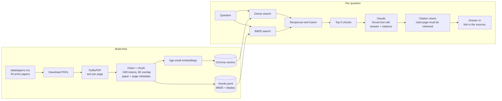

# Research Paper Assistant (RAG)

Ask questions about 50 open-access arXiv papers on **explainable AI** (2017-2023) and get an answer
with **paper and page citations**. If the papers do not contain the answer, the assistant says
**"Not in the sources."** instead of guessing.

**Why it exists.** Searching dozens of papers for one fact is slow, and chatbots will happily make
up a plausible citation. This project is built around the opposite failure mode: every claim must
point at a page that was actually retrieved, citations are machine-checked, and quality is measured
rather than eyeballed.

**Success metric.** hit@5 >= 0.8 on a 20-question eval set, and unanswerable questions are refused.
The numbers below come from `python -m evals.run_eval`, not from impressions.

## Results

<!-- RESULTS:START -->
_Not run yet. Run `python -m evals.run_eval --generate --configs baseline,small-chunks --update-readme`
and this table is replaced with your measured results._
<!-- RESULTS:END -->

What the columns mean: **hit@5** = a relevant chunk is in the top 5; **MRR** = how near the top the
first relevant chunk is; **refusal acc** = answerable questions answered and unanswerable ones
refused; **cite paper / cite page** = the answer cited the gold paper / the gold page;
**faithfulness** = share of the answer's claims the cited passages support (LLM judge).
Each configuration changes one thing from `baseline`, so every difference has one cause.

## Architecture



Details and design rationale: [docs/architecture.md](docs/architecture.md).

## Run it

```bash
python -m venv .venv && source .venv/bin/activate        # Windows Git Bash: .venv/Scripts/activate
pip install -e ".[embed,dev]"
cp .env.example .env                                      # then put your ANTHROPIC_API_KEY in it

python -m paper_assistant fetch                           # download the 50 PDFs listed in data/papers.csv
python -m paper_assistant build-index                     # chunk, embed, index (about a minute on CPU)

python -m paper_assistant ask "What metrics evaluate explanations?" --retrieval-only   # no API call
python -m paper_assistant ask "What metrics evaluate explanations?"                    # full answer

uvicorn paper_assistant.api:app --port 8000               # API: POST /ask
streamlit run src/paper_assistant/ui.py                   # UI (talks to the API)
```

Example API call:

```bash
curl -X POST localhost:8000/ask -H 'content-type: application/json' \
  -d '{"question": "How does LIME explain a prediction?", "k": 5}'
```

## Evaluate

```bash
python -m evals.run_eval                                  # retrieval only: free, no API key
python -m evals.run_eval --generate --configs baseline,small-chunks --update-readme
```

Available configurations: `baseline`, `small-chunks`, `large-chunks`, `dense-only`, `bm25-only`,
`no-references`. The eval set is `evals/dataset.jsonl`: 20 answerable questions (each tied to a
verbatim evidence phrase on a known page) and 6 unanswerable ones, including one near-miss where
the corpus discusses the EU AI Act but never mentions penalties.

## Tests

```bash
pytest          # 79 tests, no network, no model download, no API key
ruff check .
```

Tests use a deterministic fake embedder and a fake Claude client, so CI runs in seconds.

## Deploy

Docker image (builds the corpus and index at build time) and Hugging Face Spaces steps:
[docs/DEPLOY.md](docs/DEPLOY.md).

## Limitations

- **Tables lose their structure.** PDF extraction reads a table cell by cell, so table-heavy
  questions retrieve poorly. Not fixed here; a layout-aware parser would be the next step.
- **Small, single-author eval set.** 26 questions written by one person. Questions share many words
  with their evidence, which flatters keyword search; add paraphrase-heavy questions before trusting
  small differences between configurations.
- **Refusal relies on the LLM.** Fused RRF scores are not calibrated probabilities, so there is no
  retrieval-score threshold. The citation check and the eval's refusal metric are the safety nets.
- **Corpus is fixed and old** (2017-2023, mostly preprints). No LLM-era XAI work.
- **A chunk never crosses a page**, so a sentence that spans a page break is split.
- **The LLM judge can be wrong.** Faithfulness is an estimate; spot-check a few verdicts by hand.

## Layout

```
src/paper_assistant/   ingest, embedders, index, retrieve, generate, judge, pipeline, api, ui, cli
evals/                 dataset.jsonl, run_eval.py, metrics.py, results/
tests/                 pytest suite
data/papers.csv        the 50 papers (PDFs and the index are rebuilt, not committed)
```
